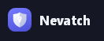

Nevatch is a VPN you run yourself, so friends and family in a censored country can use the free internet through your connection.

You run **Nevatch Server** on a computer at home (or a rented server). Your friends install the **Nevatch** app and click **Connect**. No accounts, no subscriptions, nothing to pay.

Nevatch is built on **[Xray-core](https://github.com/XTLS/Xray-core)** (VLESS + Reality), a proven tool against censorship. Nevatch makes it simple to use.

---

## What you need

- A Windows PC that stays on (or a Linux server, see [Advanced](#advanced)).
- Access to your home router's settings (usually a web page like http://192.168.1.1).
- That's all. Nothing else to install.

## Step 1: Download

Go to the [**Releases**](../../releases/latest) page and download:

- **`Nevatch-Server-<version>.exe`**: for you (the server).
- **`Nevatch-<version>.exe`**: for your friends (the app).
- **`Nevatch-Android-<version>.apk`**: the same app for your friends' Android phones.

## Step 2: Start the server

1. Double-click **`Nevatch-Server-<version>.exe`**.
   - Windows may say *"Windows protected your PC"*. Click **More info** → **Run anyway**.
   - If Windows Firewall asks, click **Allow**.
2. It asks if the server's web page needs a password. Choose **Open** if only you use this PC.
3. Click **Start server**. The shield turns green.

Closing the window keeps the server running (look for the shield next to the clock).

## Step 3: Open the door in your router

Your friends need a way in. In your router's settings, find **Port forwarding** (sometimes called *Virtual server* or *NAT*) and add a rule:

| Setting | Value |
| --- | --- |
| Port | **443** |
| Protocol | **TCP** |
| Send to | this PC (the server shows its address under *Settings → Setup checklist*) |

Every router looks different. Search the web for "port forwarding" plus your router's brand if you can't find it.

## Step 4: Add a friend

1. In the server, go to **People**.
2. Type your friend's name and click **Add person**.
3. Click **Copy key**.
4. Send your friend the **`Nevatch-<version>.exe`** file and the **key** (Telegram works well).

## Step 5: Your friend connects

Send your friend these steps:

1. Open `Nevatch-<version>.exe`. If Windows warns you, click **More info** → **Run anyway**.
2. Click **Install**.
3. Click **Add key** and paste the key.
4. Click **Connect**. The shield turns green. Done!

On an Android phone? Install **`Nevatch-Android-<version>.apk`** and paste the key, or scan it: on the PC, Nevatch's
*Servers* page has **Use on phone**, which shows the key as a QR code. On an iPhone, use the free app **Streisand**
(it can scan the same QR code).

---

## Problems?

**My friend can't connect.**
- Check the server says *Running*.
- Check the port forwarding rule (Step 3).
- Compare the internet address on your router's status page with [whatismyip.com](https://whatismyip.com). If they're different, your provider shares one address between many homes (*CGNAT*). Ask them for a *public IPv4 address*.

**It worked, but stopped after a few days.**
Your home's internet address probably changed. Get a free name at [DuckDNS](https://www.duckdns.org), put it in *Settings → Public address*, and send everyone their key again. After that, address changes don't matter.

**An antivirus deleted the app.**
This happens with VPN apps. Restore it from the antivirus's quarantine and mark it as safe.

**Something else.**
Your friend clicks **Log** → **Copy log** in the app and sends you the text.

## Good to know

- **Only give keys to people you trust.** What they do online looks like it comes from your home.
- **Remove** cuts someone off. **Disable** pauses them.
- **Updates** reach your friends' apps by themselves.
- **Less lag:** connect the server PC with a network cable instead of Wi-Fi.
- **Speed limit** per person is in *Settings → Server settings*.
- **Russian sites** (banks, Gosuslugi) skip the VPN, so they keep working.
- **Private:** Nevatch keeps no record of which websites anyone visits. VPN users can't reach your home network, can't torrent, and can't send spam.

---

## Advanced

<details>
<summary><b>Run the server with Docker (Linux, NAS or VPS)</b></summary>

1. Download `Nevatch-Server-Docker-<version>.zip` and unzip it on the machine.
2. Copy `.env.example` to `.env` and fill in `VPN_PORT`, `PUBLIC_HOST` and `ADMIN_PASSWORD`.
3. Run `docker compose up -d --build`.
4. Forward `VPN_PORT` (TCP) to this machine, or open it in your VPS firewall.
5. Open `http://<machine>:8088` and add people.

Moving from Windows? Copy `state.json` from the old server's data folder into `data` **before** the first start, so everyone keeps their keys. More details are in `README-DOCKER.md` inside the zip.

</details>

<details>
<summary><b>Run the server on Ubuntu without Docker</b></summary>

1. Install Node.js 20+ and copy the project folder over. **Include `server/data/`** if you're moving a server, or everyone needs a new key.
2. In the `server` folder, run `node setup.js`.
3. Let Xray and Node use port 443:
   ```bash
   sudo setcap 'cap_net_bind_service=+ep' bin/xray
   sudo setcap 'cap_net_bind_service=+ep' "$(readlink -f "$(which node)")"
   ```
4. Open the port: `sudo ufw allow 443/tcp`.
5. Create `/etc/systemd/system/nevatch.service`:
   ```ini
   [Unit]
   Description=Nevatch
   After=network-online.target

   [Service]
   WorkingDirectory=/opt/nevatch/server
   ExecStart=/usr/bin/node server.js
   Restart=always
   User=nevatch

   [Install]
   WantedBy=multi-user.target
   ```
   Then run `sudo systemctl enable --now nevatch`.

</details>

<details>
<summary><b>Build from source</b></summary>

You need Windows and [Node.js 20+](https://nodejs.org). The C# compiler comes with Windows.

```bat
git clone https://github.com/Mitsumashi/Nevatch.git
cd Nevatch\server
node setup.js
```

`setup.js` downloads Xray and Wintun from their official sites, checks them, builds the friend's app, and asks for a password. Then:

| Command | What it does |
| --- | --- |
| `node server.js` | Runs the server in a console window |
| `server\launcher\build.cmd` | Builds the server window (`Nevatch Server.exe`) |
| `server\publish-update.cmd` | Rebuilds the friend's app; everyone updates to it |
| `release.cmd` | Builds the release files into `release\<version>\` (the server .exe gets Node.js packed inside) |

To make a release: raise the number in `VERSION`, add a note to `CHANGELOG.md`, and run `release.cmd`.

**Keep `server/data/` private.** It holds your server's keys and your list of people. It's never added to git.

| Folder | What's in it |
| --- | --- |
| `server/` | The server (`server.js`), the web page (`public/`) and setup |
| `server/launcher/` | The server window (C#) |
| `client/` | The friend's app (C#) |
| `shared/` | The look both apps share, and the icon |
| `docker/` | Dockerfile and compose file |

</details>

## Credits and license

- [Xray-core](https://github.com/XTLS/Xray-core) (MPL-2.0) does the VPN work.
- [Node.js](https://nodejs.org) (MIT) runs the server and is packed inside the Windows server.
- [Wintun](https://www.wintun.net) provides the network adapter on Windows.

Nevatch is released under the [MIT License](LICENSE).
